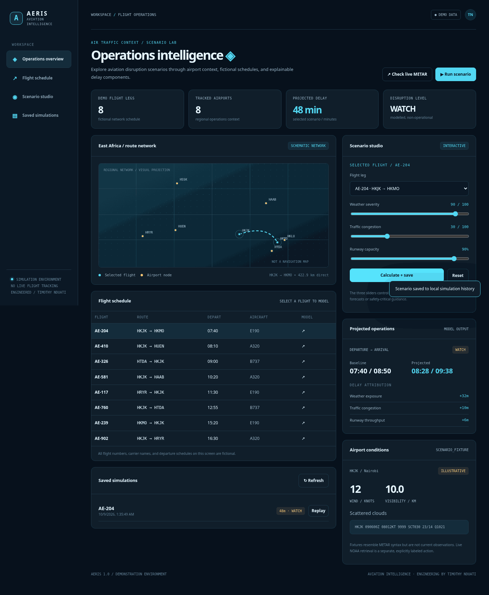

# AERIS — Aviation Operations Intelligence

> Flight operations scenario lab with airport weather, disruption simulation and route replay.

**Status:** functional demonstration / reference implementation, not a production service.

## Run locally

```bash
python -m venv .venv
source .venv/bin/activate
pip install -r requirements-dev.txt
uvicorn app.main:app --reload
# Open http://127.0.0.1:8000
pytest -q
```

Or run `docker compose up --build`.

## Features and API

Interactive browser interface served by the FastAPI backend, plus documented endpoints at `/docs`. The seed dataset is fictional or illustrative and labelled accordingly. No user accounts, real-time guarantees, routing directions, or operational decisions.


## What actually works

- Interactive East African airport/fictional flight network map and selectable schedule.
- Adjustable weather severity, congestion and runway-capacity scenario variables.
- Explainable projected departure/arrival delay and risk bands.
- Clearly marked METAR-like fixtures and optional explicitly live NOAA observation request.
- SQLite-saved scenarios and replay in the browser.

**API:** `GET /api/airports`, `/api/flights`, `/api/weather`, `/api/weather/live`, `/api/scenarios`; `POST /api/simulate`.

[Modeling and architecture notes](docs/ARCHITECTURE.md).

## Architecture

```text
Browser (HTML/CSS/ES modules)
            │ JSON over HTTP
            ▼
    FastAPI endpoints
            │
            ▼
 Domain calculations + SQLite state (where applicable)
```

- Backend: Python, FastAPI, Pydantic validation.
- Frontend: dependency-free responsive JavaScript, CSS and inline SVG.
- Test suite: pytest with API/domain test coverage.
- Environment: `DATA_DIR` sets SQLite storage directory where used.
- Container: non-root Python slim image with `/health` healthcheck.

## Scope

This repository demonstrates an end-to-end engineering concept. It does not include authentication, multi-tenancy, production monitoring, external secrets infrastructure or cloud deployment by default. Real deployments need those controls, plus domain-specific validation, before accepting production data.

## UI preview



## License

MIT
